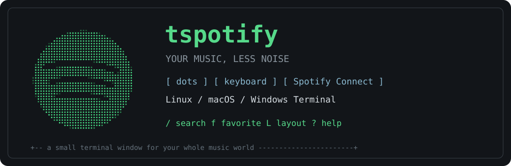

<p align="center"></p>

<p align="center">
<a href="https://github.com/user9x21imi/tspotify/releases/latest/download/tspotify-linux-x86_64.zip"></a>
<a href="https://github.com/user9x21imi/tspotify/releases/latest/download/tspotify-macos-arm64.zip"></a>
<a href="https://github.com/user9x21imi/tspotify/releases/latest/download/tspotify-windows-x86_64.zip"></a>
</p>

<p align="center">
<a href="https://github.com/user9x21imi/tspotify/actions/workflows/ci.yml"></a>
<a href="LICENSE"></a>
<a href="docs/README.ru.md">По-русски</a>
</p>

```text
+-- tspotify ---------------------------------------------------------------+
|  / Search your music                                           ? Help   |
+----------------------+----------------------------------------------------+
|  . . : : . .         |  NOW PLAYING                                        |
|  : : . . : :         |  Night Drive / Ghosts on Tape                       |
|  . : . : . :         |  =======--------------------------  1:24 / 4:12     |
|  : . : . : .         |  [f] Save / remove from your library                |
+----------------------+----------------------------------------------------+
|  SPECTRUM       . . . : : : : : : . . .                                  |
+---------------------------------------------------------------------------+
|  [1] Playlists       [2] Liked songs       [3] Albums                      |
|  .:.  Midnight sessions                                                  |
|  :::  Focus mixes                                                        |
+---------------------------------------------------------------------------+
|  VOLUME  =======---------  45%                      - / +  |  m Mute       |
+---------------------------------------------------------------------------+
```

A keyboard-driven Spotify client with **colored dotted artwork**, tiny playlist and album covers, a smooth real-audio spectrum, and movable panels. Built for a terminal — no picture escape protocols or special icon fonts.

## Install

**Download a native build above**, unpack it, and launch `tspotify` (`tspotify.exe` on Windows; `Start tspotify.command` on macOS). The first run installs the checksum-verified streaming engine if needed. Spotify Premium is required for integrated playback.

Or install with one command; this installs into your own user directory, without root/admin access:

**Linux / macOS**

```sh
curl -fsSL https://raw.githubusercontent.com/user9x21imi/tspotify/main/scripts/install.sh | sh
```

**Windows PowerShell**

```powershell
irm https://raw.githubusercontent.com/user9x21imi/tspotify/main/scripts/install.ps1 | iex
```

macOS Intel: [download x86_64](https://github.com/user9x21imi/tspotify/releases/latest/download/tspotify-macos-x86_64.zip).

Then run `tspotify`. Release archives and installer downloads are checked against `SHA256SUMS.txt`.

Want to preview the interface before signing in? `tspotify --demo` is completely offline and never plays audio.

<details><summary>Python / source installation</summary>

Requires Python 3.11 or later. Install in an isolated environment:

```sh
python -m pip install --user pipx
pipx install git+https://github.com/user9x21imi/tspotify.git
```

For development:

```sh
git clone https://github.com/user9x21imi/tspotify.git
cd tspotify
python -m venv .venv
# Activate .venv using your shell's usual command.
python -m pip install -e '.[dev]'
python -m pytest
```
</details>

## Sign in

`tspotify` opens Spotify's authorization page in your browser. If you're already signed in there, confirm access. Your Spotify password is never requested by tspotify.

For QR sign-in:

```sh
tspotify login --qr
```

For a first run that also uses QR for any separate integrated-playback approval, run `tspotify --qr`.

Scan the code, approve Spotify access, and **paste the full callback address from your phone into the terminal**. Spotify's loopback callback points to your computer; a phone cannot finish that redirect automatically. Browser sign-in on the computer is the fastest route.

Integrated streaming may ask for a separate playback approval on first use. Existing tspotify / spotify_player credentials are reused when available. tspotify does not extract credentials from the official Spotify application's private storage.

## Spotify already open?

An available, signed-in Spotify Connect device is selected automatically. This can be your desktop Spotify, MacBook, phone or another device. The terminal remains your control surface.

```sh
tspotify devices
tspotify --device "My MacBook"
tspotify --device integrated
```

Desktop Spotify being installed is not the same as it being an available device: start it and sign in first. Spotify still requires a one-time authorization for library access.

## Keys

| Key | Action |
| --- | --- |
| `/`, `F2` | Focus search; Enter submits |
| `Tab`, `Esc` | Switch focus / leave search |
| `↑` / `↓`, `PgUp` / `PgDn` | Select / scroll |
| `Enter` | Open a playlist/album; play a selected track |
| `P` | Start the whole selected playlist/album |
| `←`, `Backspace` | Return to the previous list |
| `Space`, `n`, `p` | Play/pause, next, previous |
| `+`, `-`, `m` | Volume, mute/restore |
| `F7`/`F9`/`F11`, `F8`/`F10`/`F12` | Volume down / up by 5%, including during search and in dialogs |
| `f` | Save / remove the current track from your library |
| `1`, `2`, `3` | Playlists, liked tracks, albums |
| `4`, `5`, `6`, `7`, `8` | Recent history, saved Spotify mixes, new releases, recommendations, saved daily mixes |
| `F3`, expand button, cover click | Expanded artwork, track details and a smooth dotted spectrum; F3/Esc returns |
| Mouse | Hover focuses panels; click selects, double-click opens/plays, wheel scrolls; tabs and controls are clickable |
| `a` | Dots / text ASCII / block artwork |
| `s`, `r` | Shuffle, repeat |
| `L` | Layout editor: arrows select, `K`/`J` move, `c` swaps cover side, `v` toggles spectrum, Enter saves |
| `?`, `F1` | Full key reference |
| `q`, `Ctrl+C` | Exit and stop the integrated engine |

## Fonts, terminals and transparency

Use a normal Unicode monospace font: **Cascadia Mono**, **Menlo**, **JetBrains Mono**, or **Fira Mono**. Dotted covers use standard Braille characters, not private-use Nerd Font icons. No font download or global font replacement is necessary.

If your terminal/font cannot display the dots:

```sh
tspotify --ascii
```

Recommended terminals: Windows Terminal with PowerShell, Terminal.app/iTerm2 on macOS, and Konsole/GNOME Terminal/foot on Linux. A minimum of 78 columns × 24 rows is required; a taller window gives the artwork and library more room. The application uses the terminal's background, so existing terminal transparency remains visible. Transparency itself is a terminal setting.

## Real audio spectrum

The 30 fps spectrum uses actual output audio, with separate attack/release smoothing. It does not animate random bars.

- **Linux:** PulseAudio/PipeWire monitor, using `pactl` and `parec`.
- **Windows:** WASAPI loopback through SoundCard.
- **macOS:** an output loopback device such as BlackHole is needed. Playback works without it; the spectrum panel explains when capture is unavailable. tspotify never silently records the physical microphone.

To choose a loopback device: set `TSPOTIFY_LOOPBACK` to part of its name. These are capture requirements, not playback requirements.

## Reliability and privacy

Commands are not reported as successful just because they were queued. Starting a track waits for an actual playing event or a confirmed remote-device state. Failures and Spotify rate limits are shown directly. Playlist pages and covers are cached; the screen is not completely repainted for every animation frame.

The integrated engine belongs to the terminal session and is stopped on exit, including errors and Ctrl+C. A separately running desktop Spotify remains a user-owned app.

OAuth tokens, listening data, playlist caches and logs stay in OS user-data directories. None are included in the repository, release artifacts or CI. `tspotify doctor` reports paths and capabilities without printing tokens.

## Platform and release status

CI runs unit/interface tests and builds native artifacts for Linux x86_64, macOS Apple Silicon/Intel and Windows x64. It does not have a Spotify Premium account, physical audio hardware, or permission to claim that live playback was exercised on every OS. The live account test is performed locally with the engine muted.

Release binaries are currently unsigned. macOS Gatekeeper / Windows SmartScreen may require explicit approval for an independently downloaded application. The project does not disable those OS protections.

[Architecture and testing](docs/DEVELOPMENT.md) · [Troubleshooting](docs/TROUBLESHOOTING.md) · [Release notes](CHANGELOG.md)

## Credits

Independent project, not affiliated with Spotify. Streaming uses [spotify_player](https://github.com/aome510/spotify-player), downloaded from its official releases with pinned SHA-256 hashes. Its license and third-party notices are preserved separately. The tspotify interface is [MIT licensed](LICENSE).

### Updates

Installed release builds check GitHub once a day before opening the player. A new stable release displays its version and asks `Install update? [y/N]`. Nothing installs unless you confirm. Downloads are pinned to that release and checked against its SHA-256 manifest. Spotify login and preferences are preserved. Restart `tspotify` after installation. Network failures never prevent opening the player.

Run `tspotify update` to check manually. Source checkouts keep their development environment unchanged unless you explicitly invoke this command.

### Discovery sections

Recent history includes available playlist/album contexts and unique recently played tracks. New releases and recommendations use Spotify data, with recommendations seeded by your own top tracks. Your Mixes and Daily Mixes show Spotify mixes saved in your library: save the desired mix in the official app to make it available here. These do not duplicate Spotify's private Home feed or pre-save countdowns. Availability depends on the authorization/API access granted by Spotify; restricted endpoints show an explanation rather than unrelated replacement content.

The expanded player uses 256×256 artwork and a real dotted spectrum. Mouse tracking is enabled only while the interface is open. Hold Shift when selecting text if your terminal reserves normal mouse actions for the application.

[Russian prompt for a separate SoundCloud project](docs/SOUNDCLOUD_PROMPT.ru.md).
